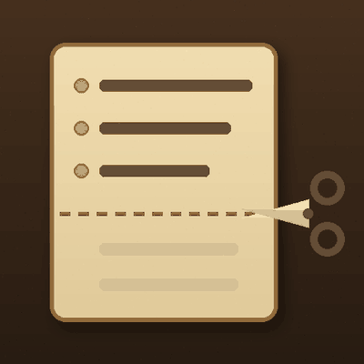

# Trim Tracker

A small WoW Forever addon that tidies up the quest tracker.

- Groups tracked quests under zone headers you can click to collapse or expand.
- Lets the tracker text go smaller than Edit Mode allows, with tighter spacing and smaller quest buttons.
- Hides the "All Objectives" header.
- Stops the tracker above your Details! windows so the two don't overlap.
- Gives the quest timer a frame of its own that you can move and size.

## Settings

Options > AddOns > Trim Tracker, or type `/trimtracker`. The settings can also be found with the options search box.

## Commands

- `/trimtracker gap`: space kept between the tracker and Details!
- `/trimtracker header`: toggle the header
- `/trimtracker zones`: toggle zone headers
- `/trimtracker spacing <0-10>`: space between quests
- `/trimtracker buttons <0.3-1>`: size of the quest map buttons
- `/trimtracker timer`: move the quest timer (again to lock), `timer <50-200>` to size it, `timer reset` to put it back
- `/trimtracker font <size>`: tracker text size, smaller than Edit Mode allows (`reset` to undo)

The old command `/trackertrim` still works.

## Installing

Install it from the WowUp Hub, or download the zip from Releases and extract the `TrimTracker` folder into `_forever_\Interface\AddOns`.

## License

GPL-3.0. See [LICENSE](LICENSE).
